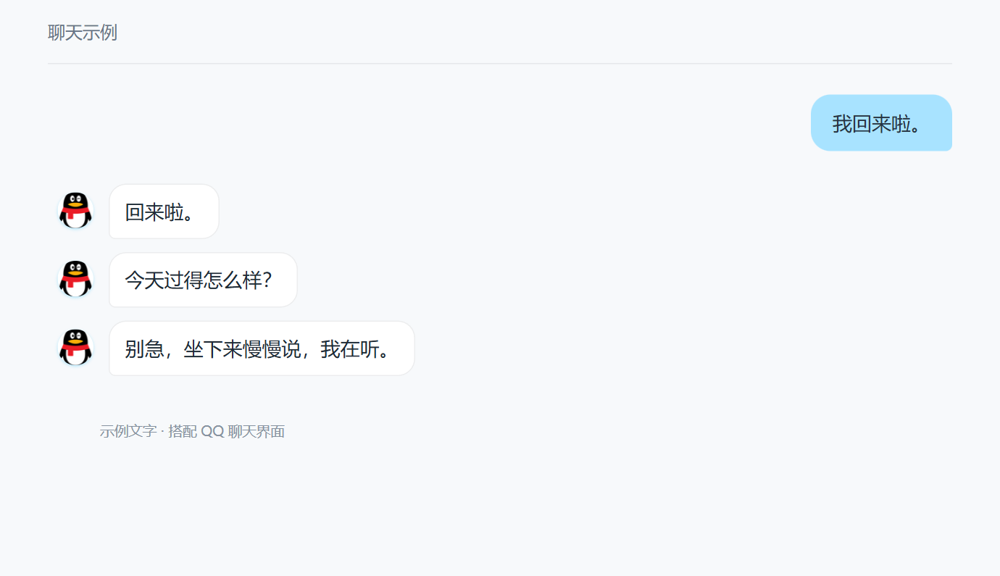
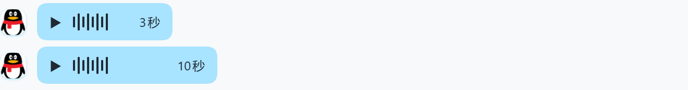

> 0.2.0-toy.7：性能修订。删除头像定时扫描和分段头像坐标测量，语音更新忽略无关界面变化并按轮次索引消息。保留 toy.6 的发送中断行为、分段、头像编辑和语音功能。安装包见下方 GitHub 预发布附件。

# QQ 聊天界面

> **先看这里：「沉浸式 QQ」默认开启。**
> 它会隐藏部分 DSH 按钮和提示，让聊天界面更像 QQ。找不到回复下方的复制、评价等按钮时，到 **设置 → QQ聊天界面 → 沉浸式 QQ** 关闭即可恢复。
> 已经手动关闭过的，升级后仍保持关闭；这个设置只改变显示，不修改聊天内容。

给 DSH 换上 QQ 风格的气泡、头像和聊天背景，支持浅色、深色与五种配色。

**目前仅适配 DSH 测试版 `0.2.1-rc.3-22ddee3`。** 从 `dsh-toy-qq` 升级时，先备份当前 profile 的配置，再停用旧包并安装本版，避免同时加载两个皮肤。

## 效果

QQ 插件已内置「对话分段」，一句回复可以分成多个聊天气泡，不需要另外安装分段插件。

搭配 Fish TTS，还可以把回复显示成可点击播放的语音条。

## 安装

**安装前请注意：QQ 聊天界面可能与其他 UI 美化插件冲突，强烈建议先关闭其他 UI 美化插件，再安装或启用本插件。** 其他皮肤、主题美化、气泡或聊天布局插件可能覆盖同一界面；独立对话分段插件也应先停用，避免重复渲染。安装后先确认界面正常，再按需逐个恢复其他插件；出现错位、重复气泡或按钮异常时，先关闭可能冲突的插件并按提示重启。

下载 [v0.2.0-toy.7 发布附件](https://github.com/Oblivious0214/dsh-toy-qq/releases/tag/v0.2.0-toy.7) 中的 `dsh-qq-skin-0.2.0-toy.7.tgz`，在 DSH 插件页通过本地安装包入口安装，完成后按提示重启。源码 ZIP 不用于安装；附件以 Release 实际发布为准。

维护分支：[feat/dsh-toy-qq](https://github.com/Oblivious0214/dsh-toy-qq/tree/feat/dsh-toy-qq)。完整改动与兼容范围见 [发布说明](RELEASE.md)。本分支通过 GitHub 附件分发，不向 npm 发布同名包。

安装后到 **设置 → QQ聊天界面** 调整外观、对话分段和语音适配；三个部分用分割线分开。点击聊天头像可以换图，也可以给不同对话设置不同头像。

语音功能需另装并配置 **Fish TTS**，再打开输入框的 **语音回复** 开关；音色在 Fish TTS 设置里调整。不需要语音时，直接当皮肤使用即可。

当前版本为 `0.2.0-toy.7`。开启分段显示即向 AI 加入分段与显示间隔规则，无需联动设备。AI 指定的间隔优先；没有指定时沿用原间隔设置；关闭「新回复逐段出现」则立即显示。配合联动玩具 `0.2.0-preview.20`，授权接入后可在对应段落切换动作，共用计时避免重复等待。

## 对话分段

配合人设插件的默认头像接口，新对话选择人设后可自动采用其头像。手动设置的会话头像优先；角色默认头像变更不会替换已经保存的会话头像。接口说明见 [人设媒体集成](https://github.com/Oblivious0214/dsh-toy-persona/blob/feat/dsh-toy-persona/docs/media-integration.md)。

默认按句末标点分段，新回复每段间隔 0.5～1.5 秒，历史回复直接显示。代码块、列表和表格保持完整，聊天原文和记录不变。分段正则、字数阈值、头像重复和节奏均在 **设置 → QQ聊天界面 → 对话分段** 调整。

从独立 `dsh-toy-segments` 升级时，先备份并记录其自定义设置，再停用该独立插件，避免两个分段渲染器同时生效；在 QQ 设置页重新填写原有分段偏好。工作区迁移工具不随公开安装包分发。

## 致谢

插件管理页显示「QQ聊天界面 · Toy 分支」，设置、按钮与提示使用「QQ聊天界面」。版本格式为 `上游主分支版本-toy.修订号`；本次基于上游 `0.2.0`（`ce7f443`），原本地 `0.4.11` 功能完整保留。同一上游基础递增 Toy 修订号，合入新上游版本后从 `toy.1` 开始。

这是基于 [lispking/dsh-qq-skin](https://github.com/lispking/dsh-qq-skin) 继续修改的维护分支，感谢原作者提供的 QQ 皮肤。保留原作者署名与 [MIT 许可证](LICENSE)。

同时感谢 [DeepSeek Harness](https://github.com/deepseek-ai/deepseek-harness) 提供宿主与插件接口，以及 [Cropper.js](https://github.com/fengyuanchen/cropperjs) 提供图片裁剪功能。[第三方许可](THIRD_PARTY_NOTICES.md)。

分段实现来自本工作区 `dsh-toy-segments@0.1.8`（提交 `494cda401aaa9acc7028a716bd7debb9a444bad8`），保留其 [来源说明](docs/segments-attribution.md)、[MIT 许可](docs/segments-LICENSE.txt) 和 [Markdown 组件许可](SEGMENTS-THIRD-PARTY-NOTICES.txt)。

当前包名：`dsh-qq-skin` · 版本：`0.2.0-toy.7` · [验证记录](VALIDATION.md) · [历史与技术说明](docs/README.previous.md)
